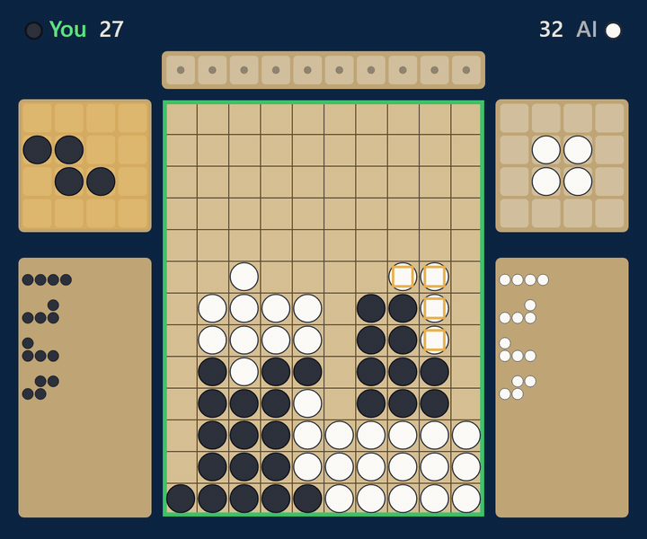
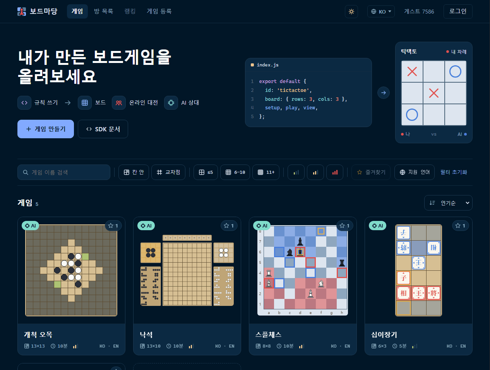
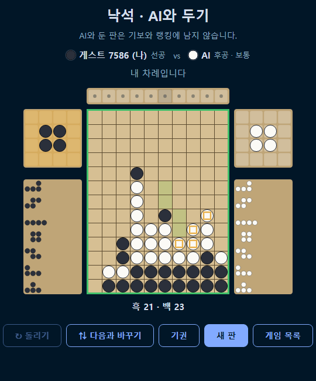
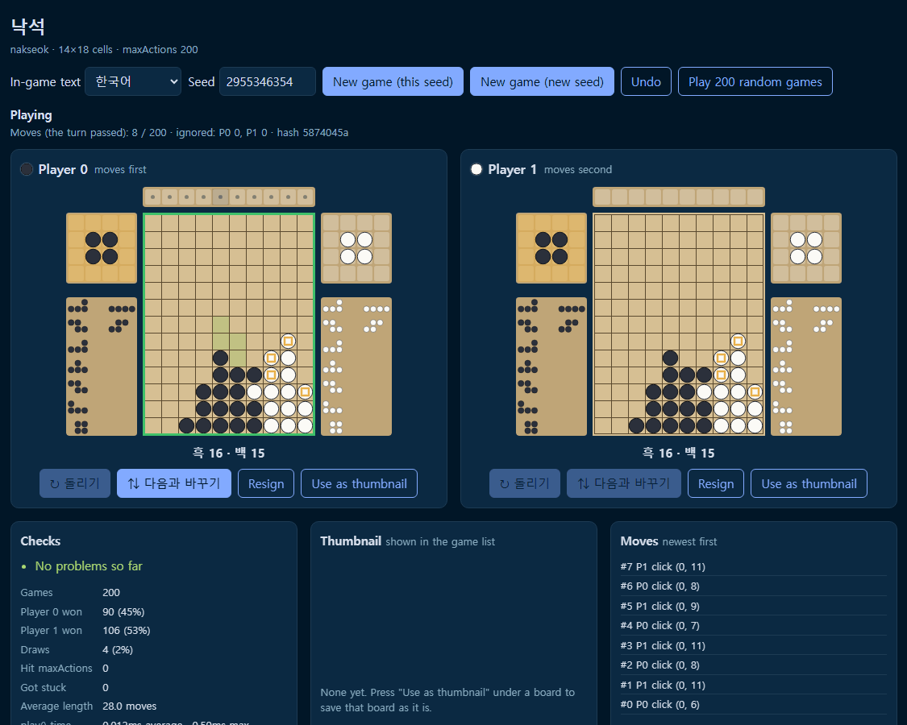

<h1 align="center">보드마당 (boardmadang)</h1>

<p align="center">
  <b>직접 만든 1대1 보드게임을 올리면, 바로 사람이나 AI와 온라인으로 둘 수 있습니다.</b><br>
  제작자는 규칙만 씁니다. 판 그리기, 대전, AI 학습은 플랫폼이 합니다.
</p>

<p align="center">
  <a href="https://boardmadang.com"><b>boardmadang.com에서 해 보기</b></a> ·
  <a href="sdk/README.ko.md">게임 만들기</a> ·
  <a href="README.md">English</a>
</p>

<p align="center">
  
</p>

> 보드마당은 아직 초기 단계이고, 완전한 오픈소스입니다. 보드게임, 게임 디자인, AI에 관심 있다면 [함께 만들어요](#기여하기).

## 무엇을 해 주나요

- **엔진 말고 규칙만.** 게임은 `setup`, `play`, `view`가 있는 자바스크립트 모듈 하나입니다. 판(칸 또는 교차점), 기물, 판 옆 패널, 떨어지고 미끄러지는 움직임, 잡히는 효과는 보드마당이 그립니다.
- **온라인 대전.** 빠른 매칭, 초대 링크가 있는 방, 대국 시계, 관전, 기보 다시보기, 재대결. 게스트로 바로 두거나 Google, GitHub로 로그인합니다.
- **AI 상대.** AlphaZero 방식 자기대국으로 학습하고, 신경망은 플레이어의 브라우저에서 돌아서 AI 대국에 서버 비용이 들지 않습니다.
- **안전한 업로드.** 올린 코드는 격리된 Web Worker에서만 돌고, 자동 검사를 통과한 뒤 제작자가 양쪽을 직접 둬서 한 판을 이겨야(클리어 체크) 공개됩니다.

<table>
  <tr>
    <td align="center"><br>게임 목록</td>
    <td align="center"><br>AI와 두기</td>
  </tr>
</table>

## 게임 만들기

[Node.js](https://nodejs.org) 18 이상이 필요합니다.

```bash
npx boardmadang new my-game   # 틱택토에서 시작
cd my-game
npx boardmadang dev           # 플레이그라운드: 양쪽을 직접 둬 보기
npx boardmadang check         # 사이트가 올릴 때 하는 검사와 같음
npx boardmadang pack          # 올릴 my-game.zip
```

게임은 객체 하나입니다. 함수는 모두 순수 함수로, 상태를 받아 새 상태를 돌려줍니다.

```js
export default {
  id: 'tictactoe',
  board: { places: 'cells', rows: 3, cols: 3 },
  pieces: 'xo',
  maxActions: 9,
  setup: () => ({ board: Array(9).fill(null), turn: 0 }),
  play(state, player, action) { /* 클릭 { row, col } → 다음 상태 */ },
  result(state) { /* 끝났으면 { winner, reason } */ },
  view(state, player) { /* 그릴 것: { pieces: [{ row, col, piece: 'x' }] } */ },
};
```

만든 zip은 [게임 등록](https://boardmadang.com/web/register.html)에서 올립니다. 자세한 안내는 [SDK 문서](sdk/README.ko.md)에 있습니다.

<p align="center">
  <br>
  <sub>플레이그라운드 (<code>npx boardmadang dev</code>): 양쪽 판을 나란히 두고, 무작위 200판 검사와 수 기록을 봅니다.</sub>
</p>

## 동작 방식

```
클릭 → (row, col)로 변환 → 서버는 순번만 붙여 양쪽에 그대로 전달
→ 양쪽 브라우저가 같은 게임 코드에 같은 클릭을 같은 순서로 넣음 → 같은 결과
```

서버는 게임 규칙을 하나도 모릅니다 (락스텝 방식). 그래서 게임 코드에는 몇 가지 규칙이 있습니다.

| 규칙 | 이유 |
|---|---|
| **격자 보드와 클릭.** 크기를 정한 격자의 칸이나 교차점에 둡니다. 입력은 칸 클릭과, 필요하면 "돌리기" 같은 버튼입니다 | 플랫폼이 판을 대신 그리고, 모든 입력이 클릭 좌표로 통일됩니다 |
| **결정적.** 랜덤은 플랫폼이 준 `rng`만 씁니다 | 양쪽 화면이 어긋나지 않습니다 |
| **완전정보 게임.** 숨겨진 패가 없습니다 | 양쪽 브라우저가 전체 상태를 갖습니다 |
| **순수 함수.** 화면, 네트워크, 저장소에 접근할 수 없습니다 | 올린 코드를 Web Worker에 가둡니다 |
| **반드시 끝남.** 최대 수(`maxActions`)가 있습니다 | 게임이 끝나야 AI를 학습시킬 수 있습니다 |

자세한 설계는 [docs/architecture.md](docs/architecture.md)를 보세요.

## AI 상대

[`trainer/`](trainer/README.md)는 게임 폴더 하나를 AlphaZero 방식(신경망 + 트리 탐색 자기대국)으로 학습시킵니다.
학습한 모델은 ONNX로 내보내 브라우저에서 돌립니다. 지금은 내 컴퓨터에서 학습하고(GPU가 있으면 좋지만 틱택토는 CPU로 몇 분), 서버에서 학습하기는 [앞으로 할 일](docs/roadmap.md)에 있습니다.

```bash
pip install -r trainer/requirements.txt
python trainer/train.py games/tictactoe --minutes 5
```

## 폴더 구조

| 폴더 | 내용 | 라이선스 |
|---|---|---|
| [`server/`](server) | Go 백엔드: 매칭, 클릭 중계, 게임 올리기, 기보 | AGPL-3.0 |
| [`web/`](web) | 사이트: 게임 목록, 대전, AI와 두기, 게임 등록 | AGPL-3.0 |
| [`sdk/`](sdk/README.ko.md) | npm 패키지 `boardmadang`: API 타입, 플레이그라운드, 검사 | MIT |
| [`games/`](games) | 예제 게임 (틱택토) | MIT |
| [`trainer/`](trainer/README.md) | AlphaZero 방식 AI 학습 | MIT |
| [`docs/`](docs) | 설계 문서 | |

## 내 컴퓨터에서 실행

```bash
cd server && go run ./cmd/server   # http://localhost:8080 에 사이트 전체
```

Go 서버 하나가 사이트 전체를 보여 주고, boardmadang.com도 같은 서버로 돌립니다.
게임만 만들 때는 Go 서버 없이 `node sdk/playground/serve.js`로 게임 목록과 플레이그라운드를 http://localhost:5173 에 띄웁니다.
개발 서버, 포트 바꾸기, 로그인 시험, 테스트는 [docs/development.md](docs/development.md)에 있습니다.

## 기여하기

보드마당은 완전한 오픈소스이고 아직 젊은 프로젝트라 할 일이 많습니다. 버그 제보, 문서, 예제 게임, 새 기능, 사이트에 올릴 새 게임 모두 환영합니다.
먼저 [CONTRIBUTING.md](CONTRIBUTING.md)를 읽어 주세요. 풀 리퀘스트는 한 번만 [기여자 라이선스 동의서(CLA)](CLA.md)에 서명하면 되고, 저작권은 기여자에게 남습니다.

## 라이선스

- `sdk/`, `games/`, `trainer/`: **MIT**
- 그 외 전부(`server/`, `web/`): **AGPL-3.0**. 수정해서 서비스로 운영하면 수정본도 공개해야 합니다.

**올린 게임은 AGPL이 되지 않습니다.** 게임의 라이선스는 제작자가 정하며, 이를 AGPL 7조의 추가 허가로 명시해 두었습니다. 자세한 내용은 [LICENSING.md](LICENSING.md)를 보세요.
