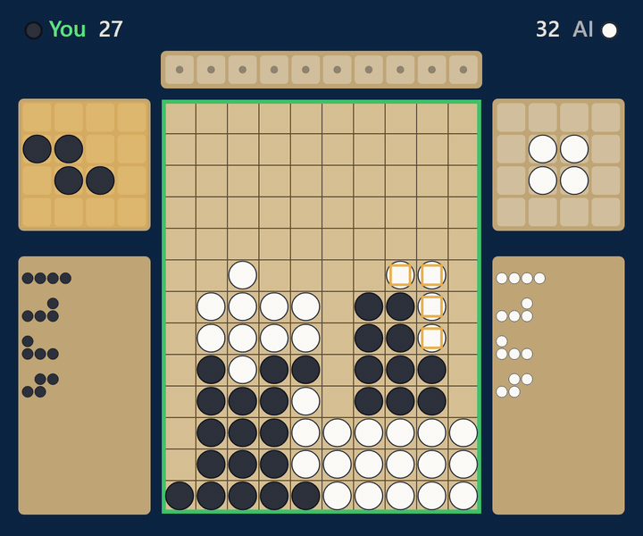
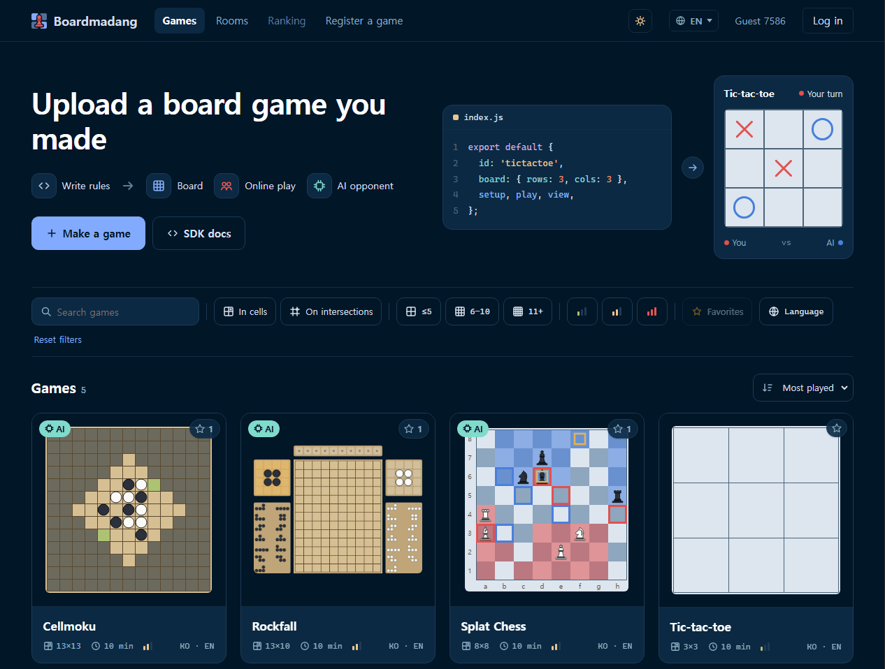
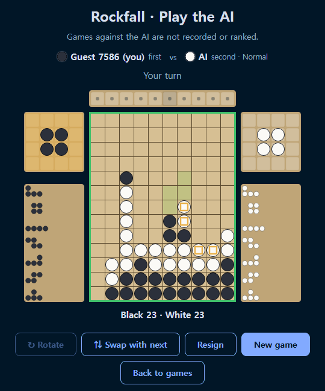
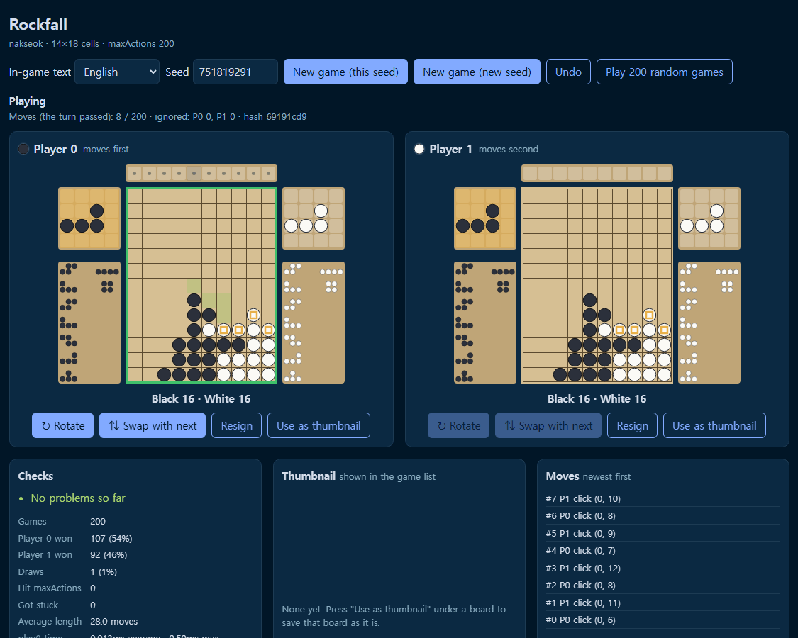

<h1 align="center">boardmadang</h1>

<p align="center">
  <b>Upload a 1-vs-1 board game you made, and play it online right away against people or an AI.</b><br>
  You write only the rules. The platform draws the board, runs the matches and trains the AI.
</p>

<p align="center">
  <a href="https://boardmadang.com"><b>Play on boardmadang.com</b></a> ·
  <a href="sdk/README.md">Make a game</a> ·
  <a href="README.ko.md">한국어</a>
</p>

<p align="center">
  
</p>

> boardmadang is early and fully open source. If you like board games, game design or AI, [come build it with us](#contributing).

## What you get

- **Rules, not an engine.** A game is one JavaScript module with `setup`, `play` and `view`. boardmadang draws the board (squares or intersections), the pieces, side panels, falling and sliding pieces, and capture effects.
- **Online play.** Quick matching, rooms with invite links, a game clock, spectating, replays and rematches. Guests can play, or log in with Google or GitHub.
- **An AI opponent.** Games are trained with AlphaZero-style self-play, and the network runs in the player's browser, so playing the AI costs no server time.
- **Safe uploads.** Uploaded code runs in a sandboxed Web Worker. A game goes live only after it passes the automatic checks and its maker wins one game playing both sides (the clear check).

<table>
  <tr>
    <td align="center"><br>The game list</td>
    <td align="center"><br>Playing the AI</td>
  </tr>
</table>

## Make a game

You need [Node.js](https://nodejs.org) 18 or newer.

```bash
npx boardmadang new my-game   # starts from tic-tac-toe
cd my-game
npx boardmadang dev           # the playground: play both sides yourself
npx boardmadang check         # the same checks the site runs on upload
npx boardmadang pack          # my-game.zip, ready to upload
```

A game is a plain object. Every function is pure: it gets the state and returns a new one.

```js
export default {
  id: 'tictactoe',
  board: { places: 'cells', rows: 3, cols: 3 },
  pieces: 'xo',
  maxActions: 9,
  setup: () => ({ board: Array(9).fill(null), turn: 0 }),
  play(state, player, action) { /* a click { row, col } → the next state */ },
  result(state) { /* { winner, reason } once the game is over */ },
  view(state, player) { /* what to draw: { pieces: [{ row, col, piece: 'x' }] } */ },
};
```

Then upload the zip on [Register a game](https://boardmadang.com/web/register.html). The full guide is in the [SDK docs](sdk/README.md).

<p align="center">
  <br>
  <sub>The playground (<code>npx boardmadang dev</code>): both boards side by side, checks over 200 random games, and the move log.</sub>
</p>

## How it works

```
a click → (row, col) → the server only numbers it and passes it to both players
→ both browsers feed the same clicks, in the same order, to the same game code → the same result
```

The server knows nothing about the rules (lockstep). That's why game code has a few rules:

- **Grid boards and clicks.** Pieces go on squares or intersections of a grid you size. Input is a click on a square, or an optional button such as "Rotate".
- **Deterministic.** Use only the `rng` the platform gives you for randomness, so both screens stay the same.
- **Perfect information.** No hidden hands, since both browsers hold the whole state.
- **Pure functions.** Game code can't touch the screen, the network or storage.
- **Games must end.** `maxActions` caps a game's length, which AI training also needs.

The full design is in [docs/architecture.md](docs/architecture.md) (Korean).

## AI opponents

[`trainer/`](trainer/README.md) trains a network for any game folder with AlphaZero-style self-play (a neural network plus tree search).
The model is exported to ONNX and runs in the browser. For now training runs on your own machine (a GPU helps, but tic-tac-toe takes a few minutes on a CPU), and training on the server is on the [roadmap](docs/roadmap.md).

```bash
pip install -r trainer/requirements.txt
python trainer/train.py games/tictactoe --minutes 5
```

## Repository

| Folder | What's in it | License |
|---|---|---|
| [`server/`](server) | Go backend: matching, click relay, uploads, replays | AGPL-3.0 |
| [`web/`](web) | The site: game list, matches, AI play, game upload | AGPL-3.0 |
| [`sdk/`](sdk/README.md) | npm package `boardmadang`: API types, playground, checks | MIT |
| [`games/`](games) | Example game (tic-tac-toe) | MIT |
| [`trainer/`](trainer/README.md) | AlphaZero-style AI training | MIT |
| [`docs/`](docs) | Design docs (Korean) | |

## Run it locally

```bash
cd server && go run ./cmd/server   # everything on http://localhost:8080
```

One Go server serves the whole site, and boardmadang.com runs the same server.
To work on games without it, `node sdk/playground/serve.js` serves the game list and the playground on http://localhost:5173.
More in [docs/development.md](docs/development.md) (Korean).

## Contributing

boardmadang is fully open source and still young, so there's plenty to do: bug reports, docs, example games, new features, and new games on the site are all welcome.
Read [CONTRIBUTING.md](CONTRIBUTING.md) first. Pull requests need a one-time [CLA](CLA.md) signature, and you keep the copyright.

## License

- `sdk/`, `games/`, `trainer/`: **MIT**
- everything else (`server/`, `web/`): **AGPL-3.0**. If you run a modified version as a service, you share your changes.

**Games you upload don't become AGPL.** You choose your game's license, and an additional permission under AGPL section 7 says so. See [LICENSING.md](LICENSING.md).
